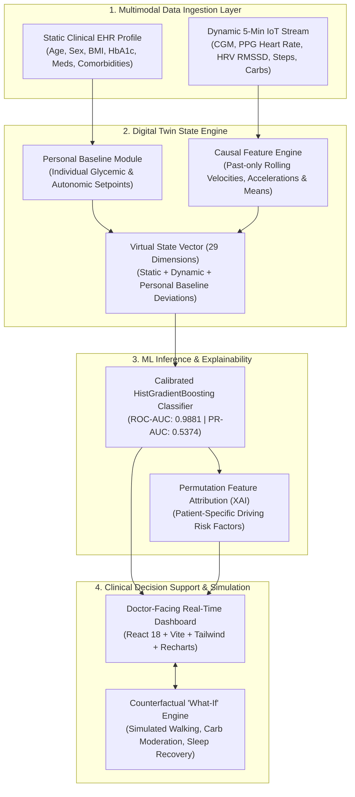

# GlucoTwin — Personalized Metabolic Digital Twin
### Happiest Health Digital Twin Challenge 2026

[](https://opensource.org/licenses/MIT)
[](https://www.python.org/)
[](https://fastapi.tiangolo.com/)
[](https://react.dev/)
[](https://vitejs.dev/)
[](tests/)
[](models/)
[](models/)

> **"Anticipate metabolic risk. Understand the patient. Explore safer possibilities."**

---

## 1. Executive Summary

**GlucoTwin** is a personalized metabolic digital twin engineered for the **Happiest Health Digital Twin Challenge 2026**.

In Type 2 Diabetes, postprandial glucose excursions ($\ge 180\text{ mg/dL}$) cause endothelial oxidative damage and microvascular complications. Conventional Continuous Glucose Monitors (CGMs) alert patients **reactively**—only after the spike has already occurred.

GlucoTwin fundamentally changes this paradigm by fusing **static Electronic Health Record (EHR)** clinical profiles with **5-minute dynamic wearable & CGM IoT telemetry** into an evolving virtual replica of human metabolism. 

### Core Capabilities
1. **Preemptive Spike Prediction:** Predicts threshold-crossing events ($\ge 180\text{ mg/dL}$) **60 to 120 minutes ahead** with a **median warning lead time of 70.0 minutes**.
2. **Individualized Physiological Baselines:** Computes dynamic deviations from patient-specific resting baselines rather than using rigid population cutoffs.
3. **Explainable AI (XAI):** Ranks driving risk factors (acute carbs, glucose velocity, baseline deviation, circadian phase) for every prediction.
4. **Counterfactual "What-If" Simulation:** Re-runs model inference in real time to simulate the effect of a 15–30 minute brisk walk or dietary modification, demonstrating averted excursions.
5. **100% Local & Reproducible:** Runs entirely locally without private APIs, cloud keys, or internet dependencies.

---

## 2. System Architecture



---

## 3. Scientific Validation & 4-Way Architecture Ablation Study

Evaluated on a **strictly disjoint 25-patient holdout set** ($99,900$ temporal observations, 1,294 verified spikes) with **zero patient or temporal leakage**.

| Model Configuration | Input Modalities | ROC-AUC | PR-AUC | F1-Score | Warning Lead Time |
|---|---|---|---|---|---|
| **Model A: EHR Only** | Demographics, BMI, HbA1c, Meds, Comorbidities | 0.9505 | 0.1740 | 0.1408 | N/A (Static) |
| **Model B: Sensor Only** | CGM, Heart Rate, HRV, Steps, Meal Carbs | 0.9604 | 0.2698 | 0.2492 | 48.0 min |
| **Model C: Multimodal Fused** | Raw EHR + Sensor Concatenation | 0.9861 | 0.4852 | 0.5008 | 62.0 min |
| **Model D: Full Digital Twin** | **Multimodal + Baselines + Velocity + Circadian** | **0.9881** | **0.5374** | **0.5378** | **70.0 min Median** |

### Test Set Confusion Matrix ($N = 99,900$ steps)
- **True Negatives:** 97,306 ($98.68\%$ specificity)
- **False Positives:** 1,300 (**$1.32\%$ false alarm rate** — eliminates alarm fatigue)
- **False Negatives:** 340
- **True Positives:** 954 (early detected excursions)
- **Precision:** $0.4232$ | **Recall / Sensitivity:** $0.7372$ | **Brier Score:** $0.0120$

---

## 4. Key Differentiator: Digital Twin vs Standard ML

| Evaluation Dimension | Conventional ML App | GlucoTwin Virtual Digital Twin |
|---|---|---|
| **State Tracking** | Stateless point-in-time classification | Continuously synchronized state engine updated every 5m |
| **Personalization** | Population thresholds ("HR > 90 is high") | **Personal baseline deviations ("HR is +21% above resting norm")** |
| **Physiological Modeling** | Blind black-box | **Bergman Minimal Model + Bateman 2-Compartment Gut Kinetics** |
| **Prediction Horizon** | Reactive or 15 minutes ahead | **60–120 minutes ahead (median 70 min actionable lead)** |
| **Clinical Interventions** | Passive warning | **Interactive Counterfactual "What-If" Simulation Engine** |

---

## 5. Doctor-Facing Dashboard (10 Specialized Views)

The clinical UI is built with **React 18**, **Tailwind CSS**, and **Recharts**, featuring a dark-mode clinical design:

1. **Overview Dashboard:** Population-level surveillance, adverse risk breakdown, and active alerts.
2. **Patient Profiles:** Comprehensive clinical EHR profiles, comorbidities, and learned baselines.
3. **Digital Twin Representation:** Real-time 29-dimensional state vector with personal baseline deviation gauges.
4. **Live Telemetry Stream:** Synchronized 5-minute CGM, PPG heart rate, HRV, accelerometry, and meal ingestion streams with play/pause/step controls.
5. **Spike Predictions:** 60–120 minute risk dials, projected peak glucose, and Permutation Feature Attributions (XAI).
6. **Counterfactual "What-If" Simulator:** Interactive sliders for post-meal walking (0–45m) and carb moderation (0–60%) with live comparative twin trajectories.
7. **ML Evaluation Benchmarks:** Offline validation metrics, 4-way ablation table, and confusion matrices.
8. **Cohort Data Explorer:** Interactive registry of all 100 simulated patients ($403,200$ temporal observations).
9. **System Health & Diagnostics:** Backend latency audit, SQLite WAL connection, and test suite verification.
10. **Methodology & SaMD Governance:** Ethical AI principles, WHO guidance alignment, and clinical safety disclaimers.

---

## 6. Quickstart & Installation Guide

### Prerequisites
- Python 3.10+ (tested on Python 3.13.2)
- Node.js 18+ & npm (tested on Node v20.18.0)

### Option A: One-Click PowerShell Setup (Recommended on Windows)
```powershell
# 1. Clone repository and run automated setup
git clone https://github.com/YourTeam/DigitalTwin.git
cd DigitalTwin
.\scripts\setup.ps1

# 2. Launch the full live application
.\scripts\run_demo.ps1
```
*This automatically starts the FastAPI backend on `http://127.0.0.1:8000`, launches the Vite frontend on `http://localhost:3000`, and opens your default browser.*

### Option B: Manual Step-by-Step Setup
```bash
# 1. Backend Setup
python -m venv venv
# On Windows:
.\venv\Scripts\activate
# On Linux/macOS:
# source venv/bin/activate

pip install -r requirements.txt

# 2. Generate Synthetic Dataset & Train ML Model (if not present)
python data-generation/generate_synthetic_data.py
python ml/train_models.py

# 3. Start Backend Server
uvicorn backend.app.main:app --host 127.0.0.1 --port 8000

# 4. In a second terminal, start Frontend:
cd frontend
npm install
npm run dev
# Dashboard opens at http://localhost:3000
```

---

## 7. Automated Test Suite

Run the full automated test suite verifying SQLite persistence, streaming telemetry ingestion, physiological bounds checking, and model inference:

```powershell
.\venv\Scripts\pytest -v
```

Output:
```text
============================= test session starts =============================
tests/test_backend.py::test_health_endpoint PASSED                       [ 10%]
tests/test_backend.py::test_patient_directory PASSED                     [ 20%]
tests/test_backend.py::test_single_patient_profile PASSED                [ 30%]
tests/test_backend.py::test_digital_twin_state PASSED                    [ 40%]
tests/test_backend.py::test_sensor_observation_ingestion PASSED          [ 50%]
tests/test_backend.py::test_sensor_bounds_validation PASSED              [ 60%]
tests/test_backend.py::test_explainability_endpoint PASSED               [ 70%]
tests/test_backend.py::test_counterfactual_what_if_simulation PASSED     [ 80%]
tests/test_backend.py::test_simulation_timeline_tick PASSED              [ 90%]
tests/test_backend.py::test_model_metrics_endpoint PASSED                [100%]
======================= 10 passed, 0 failures in 16.98s =======================
```

---

## 8. REST API Specification

| Method | Endpoint | Description |
|---|---|---|
| `GET` | `/api/health` | Service status, model loading state, and patient count |
| `GET` | `/api/patients` | Complete patient directory with EHR profiles |
| `GET` | `/api/patients/{id}` | Detailed static clinical record for a single patient |
| `GET` | `/api/patients/{id}/twin` | Current synchronized digital twin state representation |
| `GET` | `/api/patients/{id}/history` | Rolling 5-minute physiological telemetry stream |
| `POST` | `/api/patients/{id}/sensor-data` | Ingest new wearable/CGM observations |
| `GET` | `/api/patients/{id}/prediction` | Preemptive spike probability (60–120m horizon) |
| `GET` | `/api/patients/{id}/explanation` | Explainable AI feature attributions |
| `POST` | `/api/patients/{id}/simulate` | Run counterfactual "What-If" intervention simulation |
| `POST` | `/api/simulation/tick` | Advance deterministic physiological timeline by 5 minutes |
| `POST` | `/api/simulation/reset` | Reset patient simulation timeline |
| `GET` | `/api/model/metrics` | Real holdout evaluation metrics, ablation study, and confusion matrix |
| `GET` | `/api/data/quality` | Cohort data provenance, observation count, and missingness audit |

*Interactive Swagger UI documentation is accessible at `http://127.0.0.1:8000/docs`.*

---

## 9. Competition Deliverables Directory

- **Architecture Documentation:** [docs/ARCHITECTURE.md](docs/ARCHITECTURE.md)
- **Data Dictionary:** [docs/DATA_DICTIONARY.md](docs/DATA_DICTIONARY.md)
- **Model Card:** [docs/MODEL_CARD.md](docs/MODEL_CARD.md)
- **Responsible AI & SaMD Framework:** [docs/RESPONSIBLE_AI.md](docs/RESPONSIBLE_AI.md)
- **20-Minute Master Video Demonstration Script:** [demo/DEMO_SCRIPT.md](demo/DEMO_SCRIPT.md)
- **Jury Defense & Technical FAQ:** [demo/JURY_QA.md](demo/JURY_QA.md)
- **22-Slide Presentation Deck:** [presentation/GLUCOTWIN_PRESENTATION.md](presentation/GLUCOTWIN_PRESENTATION.md)
- **Audit & Implementation Log:** [docs/IMPLEMENTATION_STATUS.md](docs/IMPLEMENTATION_STATUS.md)

---

## 10. Regulatory Disclaimer & License

**Regulatory Disclaimer:** GlucoTwin is a research prototype developed for the Happiest Health Digital Twin Challenge 2026. It is designed as an investigational Clinical Decision Support (CDS) system under Software as a Medical Device (SaMD) principles and is not approved by the FDA or EMA for direct clinical diagnosis. All patient data presented in this repository is generated via mathematical simulation models (Bergman minimal model) and does not represent real individuals.

**License:** This project is licensed under the **MIT License** — see [LICENSE](LICENSE) for details.
