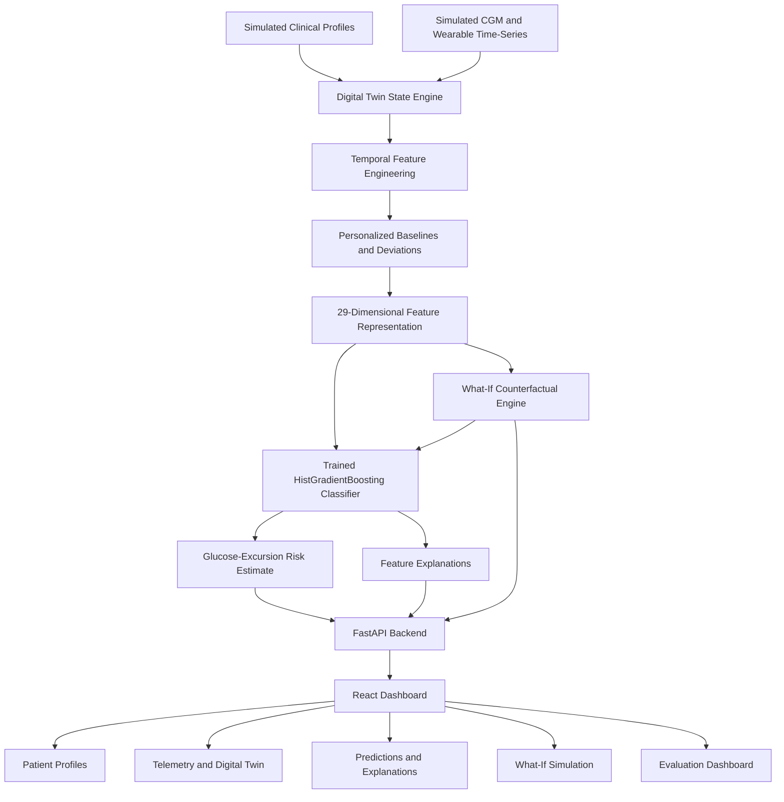

# GlucoTwin — Personalized Metabolic Digital Twin

### Happiest Health Digital Twin Challenge 2026 | Team KutShort

**Anticipate metabolic risk. Understand the patient. Explore potential interventions.**

GlucoTwin is an AI-powered healthcare Digital Twin proof of concept focused on metabolic health and glucose-excursion risk. It combines simulated clinical profiles, continuous glucose monitoring (CGM), wearable time-series, personalized physiological baselines and machine learning to estimate future glucose-excursion risk, explain model outputs and explore hypothetical lifestyle interventions.

Rather than treating a glucose measurement as an isolated number, GlucoTwin represents a patient's evolving physiological state and provides an interactive environment for investigating potential risk patterns.

> **Project objective:** Demonstrate how historical clinical information and dynamic physiological signals can be integrated into a continuously updated, explainable Digital Twin for proactive metabolic risk exploration.

---

# 1. Team Details

| Field | Details |
|---|---|
| Team Name | KutShort |
| Team Leader | Sanchita Sharma |
| Team Member | Krish Arora |
| College | Thapar Institute of Engineering and Technology (TIET) |
| Location | Patiala, Punjab, India |
| Competition | Happiest Health Digital Twin Challenge 2026 |
| Project Title | GlucoTwin — Personalized Metabolic Digital Twin |

**GitHub Repository:** https://github.com/K-Arora-10/GlucoTwin

**Project Presentation:** [(https://drive.google.com/file/d/1lEoI-KrgauHF4GEkPa72GhpsQYo3xs6N/view?usp=sharing)]

**Architecture Diagram:** [(https://drive.google.com/file/d/1oXMgtZjzb2eiGeK4d_SMu6wV5NAIpxhz/view?usp=sharing)]

**Demo Video (15–20 minutes, YouTube Unlisted):** [[https://youtu.be/82Im2nph5e4](https://youtu.be/82Im2nph5e4)]

---

# 2. Problem Statement

Metabolic health is influenced by multiple interacting physiological and lifestyle factors. Glucose levels can change in response to meals, physical activity, sleep, stress and individual physiological differences. A single glucose reading may not fully represent these interactions or indicate how the patient's state is evolving.

Conventional monitoring approaches frequently emphasize observed measurements and threshold-based alerts. Although useful, these approaches may provide limited context about changing physiological patterns, individual baselines and potential future excursions.

The challenge is to move toward a more proactive and personalized approach that integrates historical clinical information with dynamic sensor observations.

GlucoTwin addresses this challenge by building a virtual representation of a simulated patient's metabolic state. The system processes clinical context and time-series features, applies a trained machine-learning model to estimate glucose-excursion risk, provides feature-based explanations and allows users to investigate hypothetical changes in selected inputs.

## The problem GlucoTwin addresses

- **Fragmented health information:** Historical clinical context and continuously changing sensor observations need to be considered together.
- **Changing physiological state:** A patient's recent trends may provide context that a single measurement cannot.
- **Limited personalization:** Comparisons against individual baselines may provide additional context beyond population-level thresholds.
- **Limited interpretability:** Model-generated risk estimates are more useful for exploration when their influential features can also be inspected.
- **Difficulty evaluating hypothetical scenarios:** A controlled simulation environment can help users investigate how changes in model inputs affect predicted risk.

---

# 3. Healthcare Use Case

## Focus area: Type 2 Diabetes and Metabolic Health

GlucoTwin demonstrates a research-oriented Digital Twin workflow for glucose-excursion risk estimation.

The system brings together:

1. **Historical clinical context:** Simulated demographics, medical history and relevant clinical measurements.
2. **Dynamic physiological observations:** Simulated glucose measurements and available wearable signals.
3. **Personalized baselines:** Reference statistics representing the simulated patient's usual physiological patterns.
4. **Machine-learning inference:** A trained classifier that estimates the likelihood of a future glucose-threshold event.
5. **Explainability:** Feature-attribution information associated with model predictions.
6. **Counterfactual exploration:** Hypothetical modifications to supported inputs followed by fresh model inference.

### Example workflow

A researcher selects a synthetic patient and reviews the patient's clinical profile and recent glucose trajectory. The Digital Twin combines available signals with temporal features and baseline deviations. The model produces a risk estimate for the configured prediction horizon.

The researcher can then inspect the features associated with the estimate, explore a supported What-If scenario and compare the resulting model output with the baseline prediction.

This creates a closed-loop demonstration of state representation, inference, explanation and hypothetical scenario evaluation.

**Intended use:** Research, education and demonstration of healthcare Digital Twin concepts.

GlucoTwin is not a diagnostic tool, does not prescribe treatment and is not clinically validated for real-world medical decision-making.

---

# 4. Proposed Solution

GlucoTwin combines a Digital Twin state engine, a temporal feature pipeline, a trained machine-learning classifier, feature explanations and an interactive web dashboard.

The platform is designed around five principles:

- **Integration:** Combine simulated clinical context with dynamic physiological observations.
- **Personalization:** Represent deviations from individual simulated baselines.
- **Prediction:** Estimate the likelihood of a future glucose-threshold event.
- **Interpretability:** Expose information about features influencing the model output.
- **Simulation:** Recalculate model predictions after supported hypothetical input changes.

The result is a working research prototype that demonstrates the central components of a localized healthcare Digital Twin without claiming to simulate the entire human body.

---

# 5. Key Features

## 5.1 Overview Dashboard

The overview provides a consolidated view of the application, including available cohort summaries, patient information, risk indicators, simulation status and system health.

It acts as the entry point for exploring the platform and navigating between its principal capabilities.

## 5.2 Patient Profiles

The patient profile view presents simulated clinical information and historical context.

Depending on the selected record, this includes available demographic characteristics, clinical measurements, relevant medical history and individual baseline information.

Patient selection provides the context for subsequent Digital Twin, telemetry and prediction views.

## 5.3 Digital Twin State Engine

The Digital Twin state engine maintains a structured representation of the selected synthetic patient.

Its responsibilities include:

- Combining available patient context with physiological observations.
- Constructing temporal and baseline-derived features.
- Updating the current representation when new observations are processed.
- Maintaining prediction and observation history where recorded.
- Exposing the resulting state to the dashboard and simulation services.

The model uses a 29-dimensional feature representation, according to the current implementation.

The Digital Twin is intended to represent an evolving patient state rather than a static profile alone.

## 5.4 Live Telemetry and Simulation

The telemetry interface supports exploration of available physiological time-series, including glucose and wearable signals.

The simulation workflow can replay synthetic observations and update the Digital Twin as simulated time advances.

Where supported by the running implementation, the workflow allows users to start, pause, resume and reset the simulation.

The observations are simulated. They are not measurements streamed from a real patient or a connected medical device.

## 5.5 Glucose-Excursion Risk Prediction

The machine-learning component estimates the likelihood of the configured glucose-threshold event within the selected prediction horizon.

The current project uses a trained HistGradientBoosting classifier from scikit-learn.

The prediction workflow includes:

1. Feature construction from available observations.
2. Processing through the model's trained preprocessing pipeline, where applicable.
3. Model inference.
4. Returning the risk estimate and associated metadata.
5. Presenting the result through the dashboard.

The output is a model-generated estimate, not a diagnosis or a guarantee that an event will occur.

## 5.6 Explainable AI

The explainability view is intended to help users understand which input features influence a prediction.

It associates feature information with the corresponding model output and helps distinguish influential signals from the final risk estimate.

Feature attribution does not establish causation. An influential feature is not necessarily a modifiable cause of a glucose excursion.

## 5.7 What-If Counterfactual Simulator

The What-If simulator allows users to explore supported hypothetical changes to selected inputs.

The current scenarios include:

- **Physical activity:** Simulate a change in walking or activity-related features.
- **Carbohydrate reduction:** Explore a hypothetical change in recent carbohydrate-related inputs.
- **Sleep-related changes:** Explore supported changes to sleep-related and associated physiological features.

The system compares a baseline feature vector with a modified feature vector and evaluates the model again.

The interface distinguishes between increased, decreased and unchanged predicted risk.

**Important:** These scenarios are model-based counterfactuals. They do not prove that an intervention causes a particular physiological outcome. They must not be interpreted as personalized treatment recommendations.

## 5.8 Model Evaluation Dashboard

The evaluation interface presents available model performance information, including classification metrics, confusion-matrix results and ablation comparisons.

It supports examination of the trade-offs between detecting events and generating false alarms.

All evaluation figures must be interpreted in the context of the project's synthetic data and evaluation design.

## 5.9 Cohort Explorer

The cohort exploration functionality provides access to available synthetic patient records and their associated data.

It supports investigation of differences between simulated patient profiles and trajectories.

## 5.10 System Diagnostics

The system diagnostics functionality provides information about the status of the application and its available services.

It supports debugging and demonstration by helping identify whether the required backend and model components are available.

## 5.11 Methodology and Safety

The project documentation explains the data assumptions, prediction methodology, responsible-use limitations and additional validation needed before real-world deployment.

---

# 6. System Architecture

The architecture separates data sources, state representation, feature engineering, machine-learning inference, scenario simulation and the user interface.

## Architecture Diagram

**Architecture PDF/PPT:** [(https://drive.google.com/file/d/1oXMgtZjzb2eiGeK4d_SMu6wV5NAIpxhz/view?usp=sharing)]




## Architecture Components Explained

### 6.1 Simulated Clinical Profiles

This layer provides the static or historical clinical context used by the application.

It represents the Electronic Health Record component of the prototype, using simulated patient information rather than restricted real-world patient records.

### 6.2 Simulated CGM and Wearable Time-Series

This layer provides dynamic observations such as glucose measurements and available wearable signals.

The time-series supplies temporal context for the Digital Twin and enables the application to demonstrate changing physiological states.

### 6.3 Digital Twin State Engine

The state engine combines the available patient context and observations to maintain the current representation of the simulated patient.

It coordinates feature construction, prediction requests and supported state updates.

### 6.4 Temporal Feature Engineering

This layer transforms raw observations into features that can be consumed by the machine-learning model.

Depending on availability, features include recent glucose statistics, trends, velocities, accelerations, activity measures, sleep-related variables and deviations from individual baselines.

Feature construction must use only information available at the prediction timestamp.

### 6.5 Personalized Baselines

The baseline layer provides reference statistics for interpreting current observations in the context of the simulated patient's usual patterns.

Baseline deviations are model inputs, not proof of disease or causal relationships.

### 6.6 Feature Representation

The current model uses a 29-dimensional feature representation.

The representation combines supported clinical, temporal, sensor-derived and baseline-derived information into a structured model input.

### 6.7 Trained Machine-Learning Classifier

The trained HistGradientBoosting classifier processes the feature representation and produces the configured glucose-excursion risk estimate.

The prediction quality depends on the training data, target definition, feature engineering and evaluation methodology.

### 6.8 Explainability Component

The explanation component provides information about influential model features when supported by the deployed model and explanation pipeline.

Its purpose is to improve interpretability, not to establish clinical causation.

### 6.9 What-If Counterfactual Engine

The counterfactual engine creates a hypothetical modification to supported inputs, evaluates the modified state using the model and compares it with the baseline result.

The simulated result is a model estimate under specified assumptions.

### 6.10 FastAPI Backend

The backend exposes the application services to the frontend through API endpoints.

It coordinates access to patient records, Digital Twin state, predictions, history, model evaluation and scenario simulation.

### 6.11 React Dashboard

The frontend presents the application through interactive views for patient selection, state inspection, telemetry, predictions, explanations, simulation and evaluation.

The frontend communicates with the backend rather than serving as the source of truth for machine-learning predictions.

---

# 7. Technology Stack

| Layer | Technologies |
|---|---|
| Frontend | React, Vite, JavaScript |
| UI and visualizations | Tailwind CSS, Recharts |
| Backend API | Python, FastAPI |
| Validation | Pydantic |
| Machine learning | scikit-learn, HistGradientBoosting classifier |
| Data processing | Pandas, NumPy |
| Persistence | SQLite and project data artifacts |
| Testing | Pytest |
| Version control | Git and GitHub |
| Development | Python virtual environments, npm |
| Deployment support | Docker configuration, where available |

The exact dependency versions should be taken from the repository's pinned dependency files.

---

# 8. AI/ML Methodology

## 8.1 Prediction Objective

The primary prediction task is to estimate whether glucose will cross a configured threshold within a future prediction horizon.

The project defines the event using the target-construction logic in the ML pipeline. The precise threshold and horizon should be interpreted according to that implementation.

The model is intended to estimate a future event rather than diagnose diabetes.

## 8.2 Feature Engineering

The feature pipeline derives a structured representation from available clinical context and time-series observations.

Feature groups may include:

- Current glucose and recent glucose history.
- Rolling glucose statistics.
- Glucose variability.
- Glucose velocity and acceleration.
- Recent physical activity.
- Available heart-rate and HRV measurements.
- Sleep-related features.
- Relevant clinical profile variables.
- Deviations from individual baselines.
- Temporal context.

Only features supported by the actual data pipeline are used for inference.

## 8.3 Model Selection

The current implementation uses a HistGradientBoosting classifier.

Tree-based gradient boosting can model nonlinear relationships between features without requiring a GPU, making it practical for a locally runnable proof of concept.

The model's value must be judged using held-out evaluation results rather than model complexity alone.

## 8.4 Evaluation Methodology

The evaluation workflow reports classification performance and, where implemented, comparisons between feature configurations.

Important metrics include:

- ROC-AUC.
- PR-AUC.
- Precision.
- Recall.
- F1-score.
- Sensitivity and specificity.
- Confusion matrix.
- Calibration-related metrics where available.

For a trustworthy evaluation, the training and test split must prevent information leakage between patient trajectories and overlapping temporal windows.

## 8.5 Ablation Study

The project's reported ablation study compares four configurations:

- **Model A:** Clinical-profile features.
- **Model B:** Sensor features.
- **Model C:** Multimodal fusion.
- **Model D:** Full Digital Twin feature configuration.

The purpose is to investigate how the feature configurations perform under the project's synthetic evaluation methodology.

These comparisons do not independently establish clinical benefit or causality.

---

# 9. Reported Model Evaluation Results

The following figures are reported by the project's current evaluation artifacts and documentation. They are results on synthetic data, not on a clinically validated real-patient cohort.

## 9.1 Reported Ablation Results

| Configuration | ROC-AUC | PR-AUC | F1-score |
|---|---:|---:|---:|
| Model A — Clinical profile only | 0.9505 | 0.1740 | 0.1408 |
| Model B — Sensor features only | 0.9604 | 0.2698 | 0.2492 |
| Model C — Multimodal fusion | 0.9861 | 0.4852 | 0.5008 |
| Model D — Full Digital Twin features | **0.9881** | **0.5374** | **0.5378** |

The reported full configuration achieves the highest ROC-AUC, PR-AUC and F1-score among these four configurations.

## 9.2 Reported Confusion Matrix

| Metric | Reported value |
|---|---:|
| True negatives | 97,306 |
| False positives | 1,300 |
| False negatives | 340 |
| True positives | 954 |
| Precision | 0.4232 |
| Recall / sensitivity | 0.7372 |
| Specificity | 0.9868 |
| Brier score | 0.0120 |

The project also reports a median warning lead time of 70 minutes in its simulated evaluation workflow.

These figures must remain consistent with the final generated evaluation artifacts. The warning lead time is a simulated benchmark result, not a guarantee of advance warning in real-world use.

---

# 10. Data Provenance and Synthetic Data

The prototype is designed to work without requiring access to restricted patient data.

The demonstration uses simulated patient profiles and physiological time-series. These data support reproducible development and controlled exploration of the application workflow.

Synthetic data are useful for prototyping, but they cannot fully represent the complexity, variability and distribution of real-world patients.

The project does not claim that its synthetic evaluation results establish clinical effectiveness.

### Data principles

- Do not include real patient-identifiable information in the public repository.
- Clearly label generated observations as synthetic.
- Document the target definition and feature construction.
- Avoid using future observations as model inputs for earlier predictions.
- Interpret counterfactual outputs as hypothetical model estimates.
- Validate the system on appropriate external datasets before considering real-world use.

For detailed data assumptions, refer to the repository's data dictionary and provenance documentation, if present.

---

# 11. Installation and Local Execution

## Prerequisites

- Python version compatible with the repository dependencies.
- Node.js and npm compatible with the frontend.
- Git.

## 11.1 Clone the Repository

```bash
git clone https://github.com/K-Arora-10/GlucoTwin.git
cd GlucoTwin
```

## 11.2 Windows Setup

If the supplied setup script is available, run:

```powershell
.\scripts\setup.ps1
```

Start the application using:

```powershell
.\scripts\run_demo.ps1
```

Use the URLs printed by the scripts.

## 11.3 Manual Backend Setup

From the repository root:

```powershell
python -m venv venv
.\venv\Scripts\Activate.ps1
python -m pip install -r requirements.txt
python -m uvicorn backend.app.main:app --host 127.0.0.1 --port 8000
```

## 11.4 Manual Frontend Setup

Open a second terminal:

```powershell
cd frontend
npm install
npm run dev
```

Open the local URL printed by Vite. The development server commonly uses `http://localhost:5173`, but use the actual URL shown in your terminal.

The backend API documentation is expected at:

`http://127.0.0.1:8000/docs`

**Important:** Check the repository's actual directory structure and dependency files if any command fails. Do not regenerate existing model artifacts unless intentionally repeating the training workflow.

---

# 12. Testing and Build Verification

The latest reported verification following targeted fixes is:

| Verification | Reported result |
|---|---|
| Backend test suite | 14 passed |
| Frontend production build | Successful |
| Direct What-If API check | HTTP 200 |
| Test warnings | 105 warnings reported |

Run the backend tests from the repository root:

```powershell
.\venv\Scripts\python.exe -m pytest -v
```

Build the frontend:

```powershell
npm --prefix frontend run build
```

The reported test and build results verify aspects of software functionality. They do not establish clinical validity or guarantee identical results in every environment.

---

# 13. Responsible AI, Safety and Limitations

**GlucoTwin is a research prototype using synthetic or simulated data. It is not a medical device and is not intended for diagnosis or treatment decisions.**

The following limitations apply:

1. **Synthetic-data limitation:** Model performance on generated data may not generalize to real patients.
2. **Clinical validity:** The model has not been established as clinically validated based on the reported synthetic evaluation.
3. **Prediction uncertainty:** Model-generated probabilities are estimates, not certainties.
4. **Explainability limitation:** Feature attribution describes associations within a model prediction; it does not prove causation.
5. **Counterfactual limitation:** What-If outputs represent hypothetical model-input changes, not guaranteed effects of lifestyle interventions.
6. **Sensor quality:** Missing, noisy or delayed observations may affect feature construction and predictions.
7. **Deployment requirements:** Real-world use would require external validation, appropriate clinical oversight, privacy and security assessments, prospective evaluation and applicable regulatory review.

The system must not be used to diagnose diabetes, change prescribed medication or replace professional medical advice.

---

# 14. Future Scope

Potential future work includes:

- Evaluation using appropriately licensed real-world datasets.
- Independent validation across diverse patient populations.
- More rigorous temporal and patient-level validation.
- Better uncertainty estimation and probability calibration.
- Robustness assessment under sensor dropout and noisy observations.
- Validation of counterfactual simulations against observed outcomes.
- Integration with standardized healthcare data interfaces such as FHIR.
- Privacy-preserving data handling and security assessments.
- Clinical workflow evaluation before any real-world deployment.

These are potential extensions, not claims that the current prototype implements all these capabilities.

---

# 15. Competition Submission Deliverables

The following items are required for the Happiest Health Digital Twin Challenge submission.

| Required item | Submission link |
|---|---|
| Public GitHub repository | https://github.com/K-Arora-10/GlucoTwin |
| Team details | Included in this README |
| College/incubator information | Included in this README |
| Project title | Included in this README |
| Problem statement | Included in this README |
| Healthcare use case | Included in this README |
| Technical stack | Included in this README |
| AI/ML model details | Included in this README |
| 15–20 minute demo video | **[https://youtu.be/82Im2nph5e4]** |
| Open-source license | [LICENSE](LICENSE) |
| Architecture diagram (PDF/PPT) | **[https://drive.google.com/file/d/1oXMgtZjzb2eiGeK4d_SMu6wV5NAIpxhz/view?usp=sharing]** |
| Presentation (PDF/PPT) | **[https://drive.google.com/file/d/1lEoI-KrgauHF4GEkPa72GhpsQYo3xs6N/view?usp=sharing]** |
| Architecture documentation | [docs/ARCHITECTURE.md](docs/ARCHITECTURE.md) |
| Model card | [docs/MODEL_CARD.md](docs/MODEL_CARD.md) |
| Data dictionary | [docs/DATA_DICTIONARY.md](docs/DATA_DICTIONARY.md) |
| Responsible AI documentation | [docs/RESPONSIBLE_AI.md](docs/RESPONSIBLE_AI.md) |
| Demo script | [demo/DEMO_SCRIPT.md](demo/DEMO_SCRIPT.md) |
| Jury questions and answers | [demo/JURY_QA.md](demo/JURY_QA.md) |
| Implementation status | [docs/IMPLEMENTATION_STATUS.md](docs/IMPLEMENTATION_STATUS.md) |

The architecture diagram and presentation must be exported to PDF or PowerPoint format and made accessible to the evaluation team.

The demo video must be between 15 and 20 minutes and uploaded to YouTube with visibility set to **Unlisted**. Add the final video URL to this README.

Verify that all required links open without requesting additional permissions before submitting.

---

# 16. Open-Source License

GlucoTwin is distributed under the **MIT License**. See the [`LICENSE`](LICENSE) file in this repository for the complete license text.

The MIT License permits use, modification and redistribution subject to its terms. Third-party libraries and assets remain subject to their respective licenses.

---

# 17. Project Documentation

The following documentation provides additional technical information where the corresponding files are present in the repository:

- [Architecture Documentation](docs/ARCHITECTURE.md)
- [Data Dictionary](docs/DATA_DICTIONARY.md)
- [Model Card](docs/MODEL_CARD.md)
- [Responsible AI and Safety](docs/RESPONSIBLE_AI.md)
- [Demo Script](demo/DEMO_SCRIPT.md)
- [Jury Questions and Answers](demo/JURY_QA.md)
- [Presentation Source](presentation/GLUCOTWIN_PRESENTATION.md)
- [Implementation Status](docs/IMPLEMENTATION_STATUS.md)

---

## Conclusion

GlucoTwin demonstrates a localized healthcare Digital Twin proof of concept that integrates simulated clinical context, dynamic physiological features, machine-learning risk estimation, explainability and counterfactual exploration.

By combining these components in an interactive platform, the project explores how Digital Twin systems could support more contextual and proactive investigation of metabolic health.

The prototype establishes a foundation for further research, reproducible evaluation and future validation using appropriate real-world clinical data.

**Project:** GlucoTwin — Personalized Metabolic Digital Twin

**Team:** KutShort

**Repository:** https://github.com/K-Arora-10/GlucoTwin

**Challenge:** Happiest Health Digital Twin Challenge 2026

*Built to explore a future where healthcare becomes more contextual, personalized and proactive.*