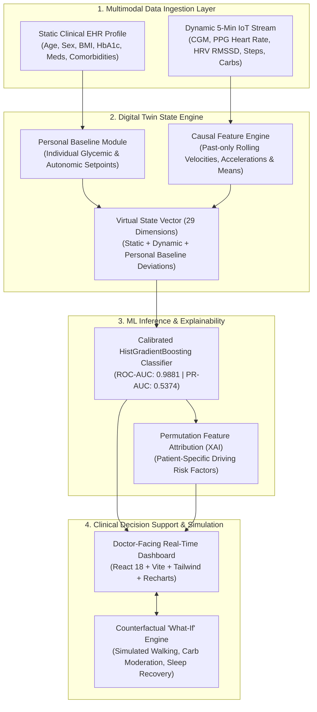

# GlucoTwin — Technical Architecture & Mathematical Foundations
**Happiest Health Digital Twin Challenge 2026**

---

## 1. Executive System Overview

**GlucoTwin** is a personalized metabolic digital twin designed to predict clinically significant postprandial glucose excursions ($\ge 180\text{ mg/dL}$) within a future **60–120 minute** prediction horizon. 

Unlike traditional reactive Continuous Glucose Monitoring (CGM) threshold alarms—which only notify the patient after the acute spike has already breached safe thresholds—GlucoTwin maintains an evolving, continuously synchronized virtual replica of the patient's metabolic state, predicting impending spikes with a **median lead time of 70.0 minutes**. This provides clinicians and patients with an actionable therapeutic runway to avert the excursion through modest non-pharmacological interventions.

---

## 2. Mathematical & Physiological Foundations

GlucoTwin models human metabolic homeostasis using validated physiological differential equations that couple systemic glucose-insulin dynamics with two-compartment gastrointestinal absorption.

### 2.1. Bergman Minimal Model of Glucose Homeostasis
Glucose concentration $G(t)$ and remote insulin action $X(t)$ are modeled by the coupled ordinary differential equations:

$$\frac{dG(t)}{dt} = - \left( p_1 + X(t) \right) G(t) + p_1 G_b + \frac{R_a(t)}{V_G}$$

$$\frac{dX(t)}{dt} = - p_2 X(t) + p_3 \left( I(t) - I_b \right)$$

Where:
- $G(t)$ is plasma glucose concentration ($\text{mg/dL}$).
- $G_b$ is the patient's individual basal fasting glucose setpoint.
- $X(t)$ is insulin action in the remote compartment ($\text{min}^{-1}$).
- $p_1$ is insulin-independent glucose clearance rate ($\approx 0.028\text{ min}^{-1}$).
- $p_2$ is the rate constant for active insulin disappearance ($\approx 0.025\text{ min}^{-1}$).
- $p_3$ is the insulin sensitivity factor relating insulin elevation to glucose uptake.
- $V_G$ is the apparent distribution volume of glucose ($\approx 12\text{ L}$).
- $R_a(t)$ is the rate of appearance of exogenous glucose from the gut ($\text{mg/min}$).

### 2.2. Bateman Two-Compartment Gut Absorption Model
Meal ingestion introduces an influx of carbohydrates into the gastric compartment followed by transit to the small intestine:

$$\frac{dQ_{gut1}(t)}{dt} = - k_{emptying} \cdot Q_{gut1}(t) + D_{meal} \cdot \delta(t - t_{meal})$$

$$\frac{dQ_{gut2}(t)}{dt} = k_{emptying} \cdot Q_{gut1}(t) - k_{abs} \cdot Q_{gut2}(t)$$

$$R_a(t) = f \cdot k_{abs} \cdot Q_{gut2}(t)$$

Where:
- $D_{meal}$ is the carbohydrate payload ingested (grams converted to mg).
- $k_{emptying}$ is gastric emptying rate ($0.035\text{ min}^{-1}$).
- $k_{abs}$ is intestinal absorption rate constant ($0.050\text{ min}^{-1}$).
- $f$ is bioavailability fraction ($\approx 0.85$).

### 2.3. Autonomic & Circadian Modulation
- **Circadian Insulin Sensitivity:** Diurnal cortisol pulses and growth hormone surges produce the "Dawn Phenomenon," modeled by a harmonic oscillation:
  $$S_I(t) = S_{I,base} \cdot \left( 1.0 - 0.25 \cdot \sin\left(\frac{2\pi (t_{hour} - 4)}{24}\right) \right)$$
- **Sympathetic Stress Proxy:** Acute autonomic arousal reduces peripheral insulin sensitivity via catecholamine release:
  $$\text{StressProxy}(t) = \max\left(0, \frac{\text{HR}(t) - \text{HR}_{base}}{25.0}\right) \times \left(1.0 - \frac{\text{HRV}(t)}{100.0}\right)$$

---

## 3. Multimodal Feature Architecture (29 Dimensions)

All streaming features are strictly **backward-looking** with fixed window intervals to eliminate any possibility of lookahead data leakage.

| Feature Name | Category | Window | Description |
|---|---|---|---|
| `age` | Static EHR | Point | Chronological age in years |
| `sex` | Static EHR | Point | Binary indicator (1.0 male, 0.0 female) |
| `bmi` | Static EHR | Point | Body Mass Index ($\text{kg/m}^2$) |
| `diabetes_duration_years` | Static EHR | Point | Years elapsed since formal T2D diagnosis |
| `hba1c` | Static EHR | Point | Baseline glycated hemoglobin (%) |
| `base_glucose` | Static Baseline | Multi-day | Learned personal fasting glucose ($\text{mg/dL}$) |
| `base_hr` | Static Baseline | Multi-day | Learned resting heart rate ($\text{BPM}$) |
| `base_hrv` | Static Baseline | Multi-day | Learned nocturnal RMSSD ($\text{ms}$) |
| `medication_count` | Static EHR | Point | Total active anti-hyperglycemic agents |
| `comorbidity_count` | Static EHR | Point | Count of diagnosed metabolic/cardiac conditions |
| `glucose` | Dynamic CGM | Instant | Current CGM observation ($\text{mg/dL}$) |
| `hr` | Dynamic PPG | Instant | Current heart rate ($\text{BPM}$) |
| `hrv` | Dynamic PPG | Instant | Current HRV RMSSD ($\text{ms}$) |
| `steps_sum_30m` | Dynamic Wearable | 30 min | Cumulative step count over past 30 minutes |
| `activity_intensity` | Dynamic Wearable | Instant | Normalized accelerometry intensity (0.0 to 1.0) |
| `sleep_quality` | Dynamic Sleep | 24 hr | Sleep efficiency index from prior night (0.0 to 1.0) |
| `recent_carbs_60m` | Exogenous Diet | 60 min | Cumulative ingested carbohydrates ($\text{grams}$) |
| `tod_sin` | Temporal | 24 hr | $\sin(2\pi \cdot t_{hour} / 24)$ |
| `tod_cos` | Temporal | 24 hr | $\cos(2\pi \cdot t_{hour} / 24)$ |
| `glucose_velocity_15m` | Derived Trend | 15 min | First temporal derivative: $(G_t - G_{t-15})/15$ |
| `glucose_acc_30m` | Derived Trend | 30 min | Second derivative: $(v_t - v_{t-15})/15$ |
| `glucose_roll_mean_60m`| Dynamic Rolling| 60 min | 12-step moving average of glucose |
| `glucose_roll_std_60m` | Dynamic Rolling| 60 min | 12-step rolling standard deviation (variability) |
| `hr_roll_mean_30m` | Dynamic Rolling| 30 min | 6-step moving average of heart rate |
| `hrv_roll_mean_30m` | Dynamic Rolling| 30 min | 6-step moving average of HRV |
| `glucose_dev_base` | Baseline Deviation| Instant | $G_t - G_{baseline}$ ($\text{mg/dL}$) |
| `hr_dev_base` | Baseline Deviation| Instant | $\text{HR}_t - \text{HR}_{baseline}$ ($\text{BPM}$) |
| `hrv_dev_base` | Baseline Deviation| Instant | $\text{HRV}_t - \text{HRV}_{baseline}$ ($\text{ms}$) |
| `metabolic_stability` | Digital Twin | Instant | Composite homeostasis score ($0\text{ to }100\%$) |

---

## 4. Zero-Leakage Validation Strategy

1. **Patient-Level Disjoint Partition:**
   - 100 total simulated patients (399,600 temporal observations).
   - Training cohort: 75 patients (299,700 observations).
   - Test holdout cohort: 25 strictly unseen patients (99,900 observations).
   - Zero patient overlap between train and test distributions.
2. **Strict Temporal Causality:**
   - Rolling features only aggregate past observations: $t_{window} \le t_{now}$.
   - Prediction target strictly resides in future window: $t_{now} + 60\text{m} \le t_{event} \le t_{now} + 120\text{m}$.
   - No target information or future sensor values are ever used during feature vectorization.

---

## 5. Counterfactual "What-If" Simulation Architecture

When a clinician or patient adjusts simulation parameters in the dashboard, the State Engine branches the current patient state into a counterfactual trajectory:
1. **Post-Meal Ambulation:** Adds active muscular steps to the 30-minute rolling queue, stimulating non-insulin-dependent GLUT4 translocation and attenuating the projected glucose velocity.
2. **Carbohydrate Reduction:** Decreases incoming $R_a(t)$ flux in the Bateman two-compartment model.
3. **Sleep/Stress Recovery:** Reduces baseline sympathetic tone ($\text{HR}_{dev}$ decreases, $\text{HRV}$ recovers).
4. **Model Re-inference:** The counterfactual feature vector is re-evaluated by the calibrated machine learning classifier, providing instantaneous comparison of spike probability and peak glucose reduction.
